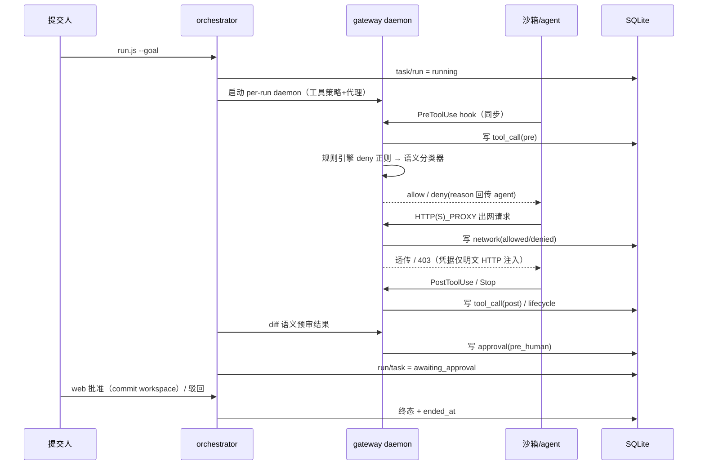

# 架构设计

## 1. 定位

agent-grid 是云端全托管 Agent 工作流的原型：控制面（编排、策略、审批、审计）与执行面（一次性沙箱 + 受限工具网关）分离。Agent 内核不自研，复用 Claude Code / Codex CLI 的非交互模式。

当前实现状态：阶段 1/2 已完成并在 local 引擎上全链路验证；docker 引擎的配方与接线已写好但未实测（`sandbox/`）。`agent_kind=codex` 可运行但无事件捕获（Codex 无 hooks 体系，属独立 spike）。

## 2. 总体结构

```mermaid
flowchart LR
    subgraph CP[控制面]
        WEB[web 审批台]
        ORCH[orchestrator<br/>run / approve / fork]
        GW[gateway daemon<br/>工具策略 + 出口代理 + events 写入]
        CLS[classifier<br/>claude -p 语义分类]
        AUDIT[审计 / 回放读取方]
        DB[(SQLite WAL<br/>tasks / runs / events / artifacts)]
    end

    subgraph EP[执行面]
        SB[一次性沙箱 / 本地进程]
        AG[Agent CLI<br/>claude | codex]
    end

    WEB -->|approve / reject| ORCH
    ORCH -->|建 task/run, 状态迁移| DB
    ORCH -->|启停 per-run daemon| GW
    ORCH -->|复制 workspace| SB
    SB --> AG
    AG -->|PreToolUse/PostToolUse/Stop<br/>HTTP hook| GW
    GW -->|唯一写入路径| DB
    GW -.->|claude -p| CLS
    AG -->|HTTP(S)_PROXY| GW
    GW -->|白名单放行 / 403, 凭据注入| EP
    AUDIT -->|只读| DB
```

分界原则：

- **控制面**做决策，持有数据库；每个 run 启动一个 gateway daemon（工具策略 + 出口代理 + 事件写入同进程，保证 `events` 单写入方、seq 无竞争）。
- **执行面**只跑 Agent CLI；工具调用经 PreToolUse hook 同步请求 daemon 拿 allow/deny，出网流量经 daemon 的代理。
- 执行面不直连数据库；hook 到 daemon 不可达时自动回落 JSONL（离线模式），run 结束后 collect 回灌，seq 从 `MAX(seq)+1` 续排。

## 3. 核心概念

| 概念 | 定义 | Schema 依据 |
|---|---|---|
| task | 人提交的工作单元 | `tasks` |
| run | task 的一次执行尝试，`agent_kind` 为 claude 或 codex | `runs` |
| thread | 分叉血缘：首 run 的 thread_id 为其自身 id，fork 的子 run 继承父的 thread_id | `runs.thread_id` |
| event | 追加式全事件流，`seq` 由 gateway 按 run 单调分配 | `events (run_id, seq)` |
| artifact | 交回人工的产物（阶段 1/2 为 diff） | `artifacts.kind` |

关系：`tasks 1 — N runs 1 — N events`，`runs 1 — N artifacts`。

## 4. 数据模型

Schema 全文见 `migrations/0001_init.sql` 与 `migrations/0002_run_workspace.sql`，约束要点：

- **Postgres 兼容子集**：TEXT 自增 id（应用生成 uuid）、RFC3339 UTC 时间戳存 TEXT、JSON 存 TEXT。阶段 3 换驱动 + 拷数据，不改 schema。
- **状态机由 CHECK 约束钉死**：
  - `tasks.status`：created / running / awaiting_approval / done / failed / cancelled
  - `runs.status`：pending / running / awaiting_approval / succeeded / failed / cancelled
- **`events` 只追加**：主键 `(run_id, seq)`；审计回放、审批、计费、异常检测全部是读取方。写入方仅 gateway（daemon/代理/collect）。
- `runs.workspace`（0002）：run 的工作区目录，fork 的复制来源；approve 时该目录被 git commit 作为后续基线。

## 5. 事件流与策略链



事件 `kind`：lifecycle / tool_call（phase: pre|post|denied）/ network（phase: allowed|denied）/ approval（stage: pre_human）。llm_request / file_change 预留未用。

策略链（daemon 内，短路）：

1. **规则引擎**：`gateway/policy.json` 的 deny 正则（pipe-to-shell、凭据文件读取等）
2. **语义分类器**：`gateway/classifier.ts` 经 `claude -p` 输出 `{risk, reason}`；medium/high → deny。故障时 deny-by-default
3. **网络白名单**：`policy.json` 的 `network.allow`（`*.domain` 通配），HTTP+CONNECT 强制；模型后端 host 经 `NO_PROXY` 自动绕过
4. **人是终审**：diff 语义预审只出风险徽章，批准/驳回在 web 台

用户全局 deny 规则（如 `Bash(curl * -o /dev/*)`）优先于 bypass 模式，依然生效。

## 6. 模块职责

全部源码为 TypeScript（ESM），`pnpm run build`（或 `make build`）用 `tsc` 编译到 `dist/`，运行走编译产物（`node dist/gateway/daemon.js`，要求 Node ≥ 24.2；包管理器为 pnpm）。下表列的是源码路径，产物与源码同构；`tsc` 无法产出的非 TS 资产（`gateway/*.json`、`sandbox/`）由 `scripts/copy-assets.mjs` 拷进 `dist/`，所以 `dist/` 自带可运行。

| 路径 | 职责 |
|---|---|
| `migrations/` | sqlite 版 0001-0004；`migrations/pg/` 为同逻辑 schema 的 PG 方言 DDL |
| `lib/db.ts` | 统一 async DB 层：文件路径 → node:sqlite，`postgres://` → pg（`?`→`$n`、`json_extract`→`::json->>` 改写） |
| `lib/types.ts` | 共享领域类型：schema 行形状（Task/Run/Event/Artifact）、policy/credentials 形状、Verdict/Decision/Finding |
| `lib/errors.ts` | `errMessage()`：`catch` 变量在 strict 下是 `unknown`，统一取错误文本 |
| `gateway/hook.ts` | 沙箱内 hook：实时 POST daemon 并应用 verdict；不可达回落 JSONL |
| `gateway/daemon.ts` | per-run 网关：工具策略链 + 挂载出口代理 + events 写入 |
| `gateway/proxy.ts` | 出口代理：白名单、CONNECT、明文 HTTP 凭据注入 |
| `gateway/classifier.ts` | 语义风险分类（claude -p + 哈希缓存） |
| `gateway/events-db.ts` | seq 分配 + 事件写入（MAX(seq)+1 续排） |
| `gateway/collect.ts` | 离线 JSONL 回灌 |
| `gateway/policy.json` | deny 正则 + 语义开关 + 网络白名单 |
| `gateway/anomaly.ts` | 异常检测（events 纯读取方，6 条规则；CLI `--json` / `--stale-hours`） |
| `orchestrator/tenant.ts` | 租户按 name 解析 + 隐式自动创建 |
| `orchestrator/run.ts` | 新建 task/run 并执行（`--tenant`，默认 default） |
| `orchestrator/fork.ts` | 复制父 workspace（副本内基线 commit）→ 共享 thread_id → 执行 |
| `orchestrator/approve.ts` | 批准（commit workspace）/ 驳回（回滚到 HEAD）；CLI + 模块 |
| `orchestrator/merge.ts` | 线程 merge：fork patch → 根 workspace 提交 |
| `orchestrator/submit.ts` / `dispatcher.ts` | 任务排队（created + params 快照）与并发调度（抢占、限流、优雅退出） |
| `orchestrator/execute.ts` | 共享执行流：daemon、agent、diff、预审、离线回落、状态迁移 |
| `sandbox/` | 一次性容器配方 + entrypoint（未实测） |
| `web/server.ts` | 审批台：任务列表（`?tenant=` 过滤）/详情、风险徽章、thread 血缘页、`/anomalies` 页、批准/驳回 |

## 7. 多租户与异常检测

- **租户**：`tenants` 表 + `tasks.tenant_id`（runs/events 经 task 归属，不冗余存）。CLI `--tenant <name>` 隐式自动创建；fork 默认继承父任务租户；web 列表带租户列与过滤。
- **异常检测**：`gateway/anomaly.ts` 是 `events` 的纯读取方（不写 events），6 条规则：deny_burst（单 run 拒绝工具调用 >= 3）、network_scan（拒绝 host >= 2）、credential_probe（工具输入命中凭据文件正则）、high_risk_diff（预审 high）、silent_run（零事件）、stale_approval（超期未审批，阈值可调）。输出到 audit CLI 与 web `/anomalies` 及 run 详情。

## 8. 阶段 3 其余能力

- **线程 merge**：`orchestrator/merge.ts <fork_run_id>` —— 在 fork 副本定位基线 commit（fork.ts 写的 `fork baseline from run ...`），快照其全部改动为 patch，`git apply --3way` 到线程根 workspace 并只提交 patch 涉及的路径；merge 命令本身是人工验收动作，fork run 随之转 succeeded/done。
- **reject 回滚**：approve.ts 的 reject 分支把工作区 `reset + restore + clean` 回 HEAD（clean 排除 `.agent-grid`/`agent.db*`，基础设施保留）。
- **HTTPS 凭据注入（CA 方案）**：`gateway/proxy.ts` 对**有凭据规则的 host** 用 openssl 生成的 CA 按需签发叶子证书做 TLS 拦截，明文 HTTP 请求上注入 header 后重新加密上行；其余 HTTPS CONNECT 保持不解密直通隧道。CA 在 `~/.config/agent-grid/ca/`（代理启动时生成），agent 经 `SSL_CERT_FILE` / `NODE_EXTRA_CA_CERTS`（execute.ts `proxyEnv()` 注入）信任。拦截事件带 `tls_intercepted`，凭据值永不入 events。
- **Runner 池化**：`orchestrator/submit.ts` 建 `created` 状态任务（params 快照，migration 0004）；`orchestrator/dispatcher.ts` 长驻轮询，条件 UPDATE 抢占（并发安全），`--concurrency N` 限流跑 `executeRun`，SIGINT 优雅排空。runner 接入点即 `executeRun` 的 engine 参数。
- **更强隔离**：run.js `--isolate 1`（docker 分支）创建 `--internal` 网络并把容器挂入——**未实测**，`host.docker.internal` 在 internal 网络上的可达性是开放假设。
- **Postgres 切换（已实测）**：`lib/db.ts` 统一 async DB 层——`--db` 传文件路径走 `node:sqlite`，传 `postgres://` 走 `pg`；PG 侧做 `?`→`$n` 与 `json_extract`→`::json->>` 改写。DDL 为同逻辑 schema 的方言版 `migrations/pg/0001-0004`。全部调用点（gateway/orchestrator/web）已 async 化。验证：5 表结构逐列一致、双后端异常检测结果逐条一致、`run.js --db postgres://` 全链路（执行→事件→diff→审批）通过。

## 9. 路线

1. **阶段 1（最小闭环）** — 已完成：任务 → 本地 agent → 事件落库 → diff 人工审批
2. **阶段 2（管控）** — 已完成：实时网关 deny、语义审批、线程分叉、网络白名单 + 凭据注入（CA 方案含 HTTPS）
3. **阶段 3（规模化）** — 已完成（本地可验证范围）：多租户、异常检测、线程 merge、reject 回滚、Runner 池化（并发调度器）、SQLite → Postgres（双后端实测）；更强隔离仅接线未实测

## 10. 已知边界

- docker 引擎接线完成但未实测；出口代理为约定式（env 引导），`--noproxy` 可绕过；`--isolate 1`（internal 网络）仅接线未实测
- 凭据文件在 `~/.config/agent-grid/credentials.json`（repo 外）；HTTPS 拦截仅对有凭据规则的域；系统 curl 对自签 CA 的信任依赖 `SSL_CERT_FILE`（brew curl 确定生效，macOS 系统 curl 未逐一验证）；git/libcurl 的 CA 信任同样未逐一验证
- codex 无事件捕获；线程 merge 不处理与根 workspace 的语义冲突（`git apply --3way` 失败即报错退出）
